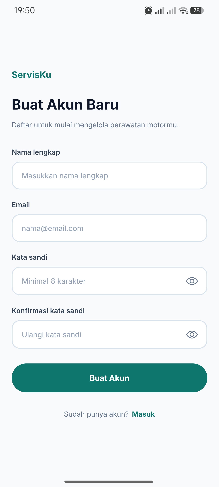
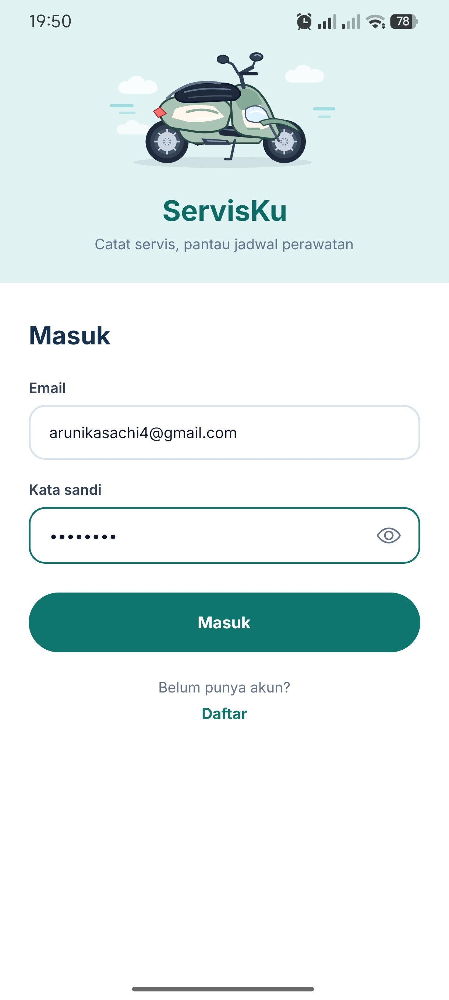
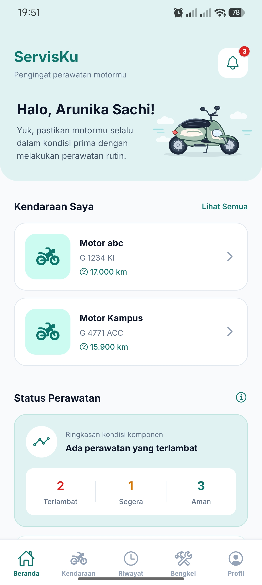
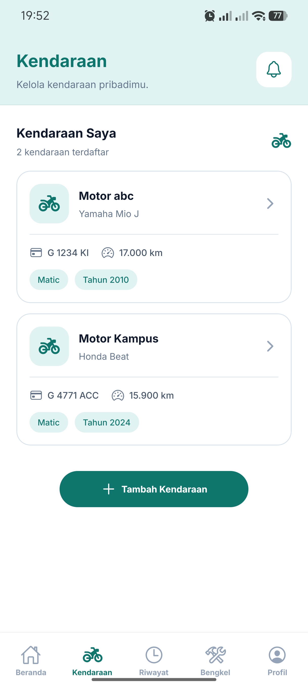
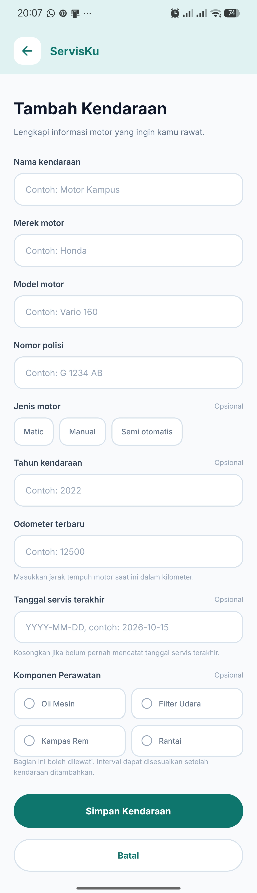
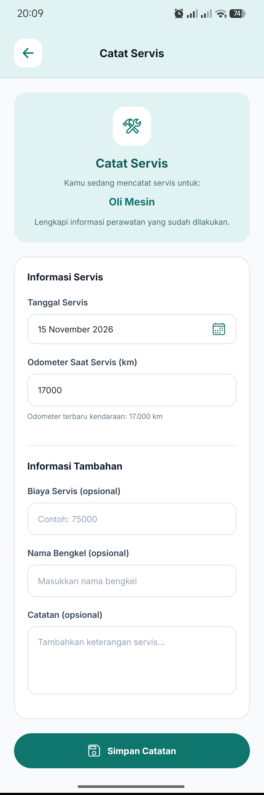
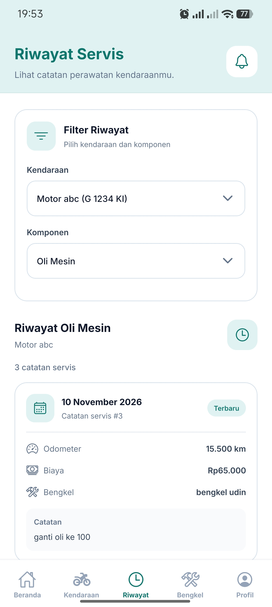
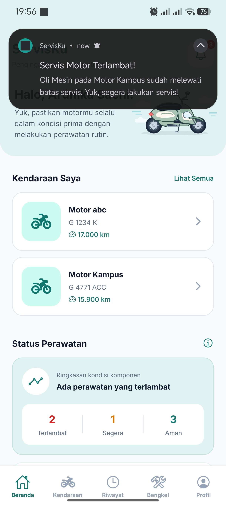
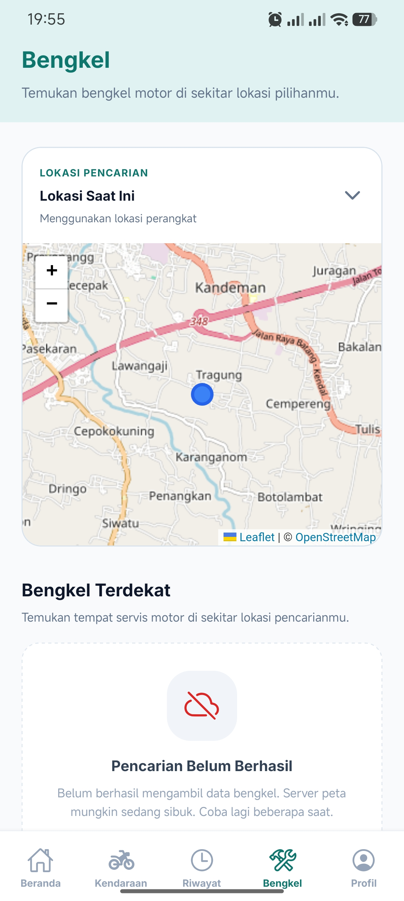

# ServisKu

Aplikasi mobile untuk mencatat dan mengingatkan jadwal perawatan sepeda motor. Pengguna mencatat kendaraan, menentukan interval servis tiap komponen (berdasarkan kilometer dan/atau bulan), lalu aplikasi menampilkan status perawatan (**Aman**, **Segera**, **Terlambat**) dan mengirim pengingat lewat notifikasi.

Proyek akhir mata kuliah **Pemrograman Berbasis Platform (INF2528)**, Program Studi Informatika, UIN K.H. Abdurrahman Wahid Pekalongan.

Pembuat: Ari Maulida Aprilia

## Unduh APK

Unduh APK untuk Android melalui halaman build EAS:

**[Unduh ServisKu (APK)](https://expo.dev/accounts/apill20/projects/ServisKu/builds/8daf7b05-3507-4f46-b562-5d2c8af3c22d)**

Setelah diunduh, izinkan instalasi dari sumber tidak dikenal jika diminta oleh Android. Saat pertama dibuka, izinkan akses notifikasi dan lokasi agar pengingat dan pencarian bengkel dapat berfungsi.

## Tangkapan layar

<table>
  <tr>
    <td align="center"><br><sub>Register</sub></td>
    <td align="center"><br><sub>Masuk</sub></td>
    <td align="center"><br><sub>Beranda</sub></td>
    <td align="center"><br><sub>Kendaraan</sub></td>
    <td align="center"><br><sub>Tambah kendaraan</sub></td>
  </tr>
  <tr>
    <td align="center"><br><sub>Catat servis</sub></td>
    <td align="center"><br><sub>Riwayat</sub></td>
    <td align="center"><br><sub>Notifikasi</sub></td>
    <td align="center"><br><sub>Bengkel terdekat</sub></td>
  </tr>
</table>

## Fitur

- **Akun pengguna**: daftar dan masuk menggunakan Supabase Auth.
- **Manajemen kendaraan**: tambah, lihat, ubah, dan hapus kendaraan beserta odometernya.
- **Komponen perawatan**: tiap kendaraan memiliki komponen (misalnya oli) dengan interval kilometer dan/atau bulan.
- **Status perawatan**: Beranda menampilkan ringkasan komponen yang Terlambat, Segera, dan Aman, serta jadwal servis berikutnya.
- **Catat servis dan riwayat**: mencatat servis per komponen dan melihat riwayatnya.
- **Pengingat notifikasi**: notifikasi lokal berdasarkan status kilometer dan tanggal servis.
- **Cari bengkel**: menampilkan bengkel di sekitar lokasi pada peta, dengan data dari OpenStreetMap.

## Teknologi

- React Native dan Expo (Expo Router untuk navigasi)
- TypeScript
- Supabase (autentikasi dan database PostgreSQL)
- `expo-notifications` (notifikasi lokal) dan `expo-location`
- Leaflet di dalam WebView untuk peta

## Sumber data dan layanan pihak ketiga

| Layanan                   | Fungsi                                    |
| ------------------------- | ----------------------------------------- |
| Supabase                  | Autentikasi dan penyimpanan data pengguna |
| OpenStreetMap (tile peta) | Tampilan peta                             |
| Overpass API              | Mengambil data bengkel dari OpenStreetMap |
| Photon (Komoot)           | Pencarian nama lokasi                     |
| Leaflet (unpkg)           | Pustaka peta yang dimuat di WebView       |

Data peta &copy; [OpenStreetMap contributors](https://www.openstreetmap.org/copyright).

Catatan: Overpass dan Photon adalah layanan publik dengan batas pemakaian. Saat server sedang penuh, pencarian bengkel dapat gagal atau lambat. Periksa kebijakan pemakaian masing-masing layanan sebelum dipakai untuk keperluan lain.

## Menjalankan dari kode

Prasyarat: Node.js, npm, dan proyek Supabase.

```bash
git clone https://github.com/apill20/ServisKu.git
cd ServisKu
npm install
```

Buat berkas `.env` di folder proyek (berkas ini tidak masuk ke Git):

```env
EXPO_PUBLIC_SUPABASE_URL=isi_dengan_url_proyek_supabase
EXPO_PUBLIC_SUPABASE_ANON_KEY=isi_dengan_anon_key_supabase
```

Gunakan hanya kunci **anon/public**. Jangan pernah memasukkan kunci `service_role`.

Jalankan aplikasi:

```bash
npx expo start
```

Catatan: notifikasi lokal tidak dapat diuji secara penuh di Expo Go. Gunakan APK hasil build untuk menguji notifikasi.

## Membuat APK

1. Tambahkan variabel `EXPO_PUBLIC_SUPABASE_URL` dan `EXPO_PUBLIC_SUPABASE_ANON_KEY` pada environment **preview** di halaman Environment variables proyek EAS (expo.dev).
2. Jalankan:

```bash
npx eas-cli build --platform android --profile preview
```

Profil `preview` pada `eas.json` menghasilkan berkas APK.

## Database

Aplikasi memakai tabel `profiles`, `kendaraan`, `komponen_perawatan`, dan `catatan_servis`, serta fungsi database `tambah_kendaraan_lengkap`. Akses data dibatasi per pengguna dengan Row Level Security.

Skema database dan kebijakan Row Level Security tersedia di [supabase/schema.sql](supabase/schema.sql).

## Lisensi

Lihat berkas [LICENSE](LICENSE).
